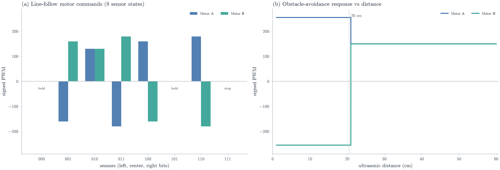

# Robot Car

> A 4-wheel Arduino robot car with Bluetooth control, IR remote, obstacle avoidance, and infrared line tracking, driven from a custom Android app.

[](https://www.arduino.cc)
[](https://developer.android.com)
[](https://www.java.com)
[](LICENSE)

This project is a 4-wheel robot car built on an Arduino UNO. It supports three control methods: a custom Android Bluetooth app, an IR remote, and two autonomous modes. The car uses an HC-05/HC-06 Bluetooth module to receive commands from the phone, a servo-mounted HC-SR04 ultrasonic sensor for obstacle detection, and three infrared sensors on the underside for line tracking.

The companion Android app is written in Java and communicates with the car over Classic Bluetooth (SPP). It features a D-pad for manual driving with hold-to-move controls, a one-tap obstacle avoidance toggle, and a one-tap line tracking toggle, all in a clean dark-themed UI.


## Installation

### 1 - Upload the Arduino Sketch

**Requirements:**
- [Arduino CLI](https://arduino.github.io/arduino-cli/) 1.5.x or newer (or the Arduino IDE 1.8.x+)
- Arduino UNO (or compatible board)
- `Servo` library 1.1.3 (installed via `arduino-cli lib install Servo@1.1.3`)

**Steps (arduino-cli):**

```sh
# Clone the repository
git clone https://github.com/Creator101-commits/robot-car.git
cd robot-car

arduino-cli core install arduino:avr@1.8.8
arduino-cli lib install Servo@1.1.3
arduino-cli compile --fqbn arduino:avr:uno \
  --libraries firmware/libraries firmware/robot_car
arduino-cli upload --fqbn arduino:avr:uno --libraries firmware/libraries firmware/robot_car
```

**Steps (Arduino IDE):** the sketch is `firmware/robot_car/robot_car.ino`. The local libraries in `firmware/libraries/` (`RobotCarCore`, `IRremote`) must be visible to the IDE, either by copying them into your sketchbook `libraries/` folder or via **Sketch > Include Library > Add .ZIP Library**. Select **Tools > Board > Arduino UNO**, pick the port, and upload.

---

### 2 - Build the Android App

**Requirements:**
- JDK 17
- Android SDK with platform `android-37.2` and build-tools (the Gradle build installs what it needs, or install via `sdkmanager`)
- A physical Android device (emulators do not support Bluetooth)

**Option A - Android Studio:**

1. Open Android Studio and choose **Open an Existing Project**.
2. Navigate to `android-app/` and open it.
3. Let Gradle sync finish.
4. Connect your Android phone via USB with **USB Debugging** enabled.
5. Click **Run** (or press `Shift+F10`).

**Option B - Command Line:**

```sh
cd android-app
./gradlew assembleDebug
# APK -> app/build/outputs/apk/debug/app-debug.apk

# Install directly to a connected device
./gradlew installDebug
```

---

### 3 - Pair the Bluetooth Module

Before using the app, pair the HC-05 / HC-06 from your phone's system settings:

1. Power on the robot car.
2. Go to **Android Settings > Bluetooth**.
3. Scan and pair with **HC-05** or **HC-06** (default PIN: `1234` or `0000`).
4. The device will now appear in the app's connection list.

## Usage example

**Manual driving:**

Launch the app, tap **Connect to Bluetooth**, and select your module. Once the status bar turns green, use the D-pad to drive. Hold any direction button to keep moving; the car stops the moment you lift your finger.

```
Hold Forward   -> car moves forward at full speed
Hold Back      -> car reverses
Hold Left      -> rotates left
Hold Right     -> rotates right
Tap  Stop      -> immediate stop, exits any active mode
```

**Obstacle Avoidance mode:**

Tap the **Obstacle Avoidance** button once. The car drives forward autonomously. When an object is detected within 20 cm, it stops, sweeps the ultrasonic sensor left and right, then turns toward whichever side has more clearance. Tap the button again (or tap Stop) to return to manual control.

**Line Tracking mode:**

Tap **Line Tracking**. The three IR sensors on the underside of the car detect a dark line on a light surface and steer the car to follow it automatically. Tap the button again to stop.

**IR Remote:**

The car also responds to a standard NEC IR remote. The arrow keys map to Forward / Back / Left / Right and the OK button stops the car. IR control and Bluetooth control can be used at the same time; whichever sends a command last takes effect.

## Protocol

Bluetooth commands are framed as `%X#` (for example `%F#`); anything else is ignored by the parser. Frames longer than 4 bytes stop the car.

| Command | Action |
|---------|--------|
| `F` | Drive forward (held ~500 ms) |
| `B` | Drive backward (held ~500 ms) |
| `L` | Rotate left (held ~300 ms) |
| `R` | Rotate right (held ~300 ms) |
| `S` | Stop |
| `T` | Enter line-tracking routine |
| `A` | Enter obstacle-avoidance routine |

`T` and `A` run their autonomous routine until a new command (typically `S`) arrives. A frame with any other command character (for example `%Z#`) parses successfully but matches no case: it is a no-op that, like `T`/`A`, leaves the buffer in place. The app never sends such frames.

The same table is implemented in `firmware/libraries/RobotCarCore` (parsed and dispatched by the sketch) and in `android-app/.../CommandProtocol.java` (the app's only source of command bytes). The firmware host tests and the JUnit tests both assert this table.

IR remote keycodes (NEC): Up `0x46`, Down `0x15`, Left `0x44`, Right `0x43`, OK `0x40`. Up/Down/Left/Right drive or turn, OK stops.

## Wiring

| Pin | Component |
|-----|-----------|
| 2, 4 | Motor A direction (IN1, IN2) |
| 5 | Motor A PWM |
| 6 | Motor B PWM |
| 7, 8 | Motor B direction (IN3, IN4) |
| 9, 10, 11 | IR line sensors (Left, Center, Right) |
| 12 | IR receiver |
| A0 | HC-SR04 Echo |
| A1 | HC-SR04 Trigger |
| A2 | Servo (sensor pan) |

## Development setup

**Firmware:**

`firmware/robot_car/robot_car.ino` contains only Arduino glue (pins, `setup`/`loop`, sensor reads, motor writes). All decision logic lives in `firmware/libraries/RobotCarCore/`, an Arduino-free library so the same code compiles and runs on the host.

```sh
# Host characterization tests for the decision logic (plain asserts, no framework)
make -C firmware/test

# Compile the UNO sketch without uploading
arduino-cli compile --fqbn arduino:avr:uno \
  --libraries firmware/libraries firmware/robot_car
```

**Android:**

The app is a standard Android Gradle project. Open `android-app/` in Android Studio and sync.

```sh
cd android-app
./gradlew assembleDebug      # debug APK
./gradlew testDebugUnitTest  # JUnit tests (CommandProtocol table)
./gradlew lint               # Android lint
```

## Verified

Verified on this machine (macOS, Arduino CLI 1.5.1, `arduino:avr` 1.8.8, JDK 17, Gradle 9.9.1, AGP 9.5.1, compileSdk 37.2):

- `arduino-cli compile --fqbn arduino:avr:uno` on `firmware/robot_car`: **9,078 bytes flash (28% of 32,256), 551 bytes RAM (26% of 2,048)**.
- Host tests (`make -C firmware/test`): **112 checks, 0 failures**, covering Bluetooth framing/dispatch, line-follow decisions, avoidance thresholds and turn direction, IR key mapping and pending-state behavior, and pin constants.
- Android: `./gradlew assembleDebug testDebugUnitTest lint` passes; **3 JUnit tests, 0 failures**; lint reports **0 errors** (4 informational version notices).
- CI (`.github/workflows/ci.yml`) runs the host tests, the UNO compile and the Android build on every push.

### Decision logic, rendered from the firmware



The figure is rendered by `tools/render_figure.py`, which compiles
`firmware/libraries/RobotCarCore` with `g++` (the same flags as
`firmware/test/Makefile`), runs `tools/robotcar_dump.cpp`, and plots
the `MotorCommand` decisions it prints. Regenerate with
`uv run --with matplotlib python tools/render_figure.py`. Like the rest
of this section it is **host-verified logic, not hardware-tested
behavior**; the firmware does not name wheel sides, so the motors are
labeled Motor A and Motor B.

#### What the figure shows

- (a) Line-following motor commands for the 8 line-sensor states
  (bits = left, center, right): only the center-on pattern drives
  straight ahead at PWM 130; single-side errors turn or pivot at
  160-180 with opposite signs on Motor A and Motor B; all-black stops;
  all-white and the left+right split produce no command at all
  ("hold", the last motion persists).
- (b) Obstacle-avoidance response over 1-60 cm with a self-consistent
  reading (front = left = right): the car cruises forward at PWM 150
  outside the band and turns at PWM 255 inside 1-20 cm; the dotted
  line marks the 20 cm threshold, and the tie rule
  (`right <= left`) always rotates left on equal readings.

The whole autonomous behavior is two small decision tables: line
following recenters on the line, and avoidance turns inside 20 cm.

## Not verified

The following have not been exercised on real hardware and are unverified:

- On-car driving behavior, motor wiring direction, and real sensor calibration (ultrasonic distance, IR line thresholds).
- Real Bluetooth pairing and SPP communication with an HC-05/HC-06.
- IR remote decoding on the actual receiver and remote.
- Behavior on physical Android devices (only compilation, unit tests and lint were run).

## Notes

- `firmware/libraries/IRremote/` is a custom NEC IR decoder plus keymap that shipped with the project. It carries no license header or attribution; its provenance is unknown (likely derived from the robot kit or a tutorial). It was moved into a proper Arduino library layout unchanged except for one bug fix: keymap lookups previously iterated `KEY_MAX` (21) entries over a 17-entry table and could read past the end; lookups are now bounded by the real table sizes.
- The Android dependency versions are the newest releases that still support `minSdk 21`; newer `core`/`appcompat`/`material` releases require `minSdk 23`.
- The app requests only `BLUETOOTH_CONNECT` at runtime on API 31+; it lists bonded devices only and never scans, so `BLUETOOTH_SCAN` and location permissions are not declared. Legacy `BLUETOOTH`/`BLUETOOTH_ADMIN` are kept with `maxSdkVersion="30"`.

## Behavior changes from the original sketch

The rebuild preserves the original decision logic, with these disclosed differences:

- **IR key reads:** the original called `ir.getCode()` up to 5 times per loop in its if/else chain, and `IRremote::loop()` clears `irRead` about 1 ms after a decode, so reads within one iteration could see different values and some keypresses could be missed. The rebuild reads the code once per loop, which is deterministic. This is a deliberate fix, kept as-is.
- **Keymap bounds:** `getKeyMap`/`getIrKey` iterated `KEY_MAX` (21) entries over a 17-entry table and could read past the end; lookups are now bounded by the real table sizes (see Notes).
- **Compile fixes:** the sketch did not compile as committed (`IR_remote.h` missing, then `Servo.h`); resolved by proper libraries under `firmware/libraries/`.
- **Launcher icons:** the project had no `mipmap` resources, so resource linking could never succeed; simple generated PNG icons were added.
- **Status string:** the hardcoded "Connected" text (which contained an em dash) is now a string resource, `Connected: %1$s`.
- **Distance units:** ultrasonic distances are whole centimeters, truncated exactly like the original `volatile int` globals (`(int)(echo_us / 58.00)`); an earlier float version of this logic was corrected.

## Release History

* 1.0.0
    * Initial release
    * ADD: Bluetooth manual control via Android app
    * ADD: Obstacle avoidance mode (HC-SR04 + servo sweep)
    * ADD: Infrared line tracking mode (3 sensors)
    * ADD: IR remote control (NEC protocol)

## Meta

Distributed under the MIT license. See `LICENSE` for more information.

[https://github.com/Creator101-commits/robot-car](https://github.com/Creator101-commits/robot-car)

## Contributing

1. Fork it (<https://github.com/Creator101-commits/robot-car/fork>)
2. Create your feature branch (`git checkout -b feature/myFeature`)
3. Commit your changes (`git commit -am 'Add myFeature'`)
4. Push to the branch (`git push origin feature/myFeature`)
5. Create a new Pull Request

## Acknowledgments

* [LAFVIN](https://www.lafvin.com) for the robot car kit that this project is built on. The LAFVIN 4WD smart car kit provides the chassis, motors, motor driver board, HC-SR04 ultrasonic sensor, IR sensors, and servo mount used in this build. They also provided the foundational code but I edited a lot of it to my custom robot.
