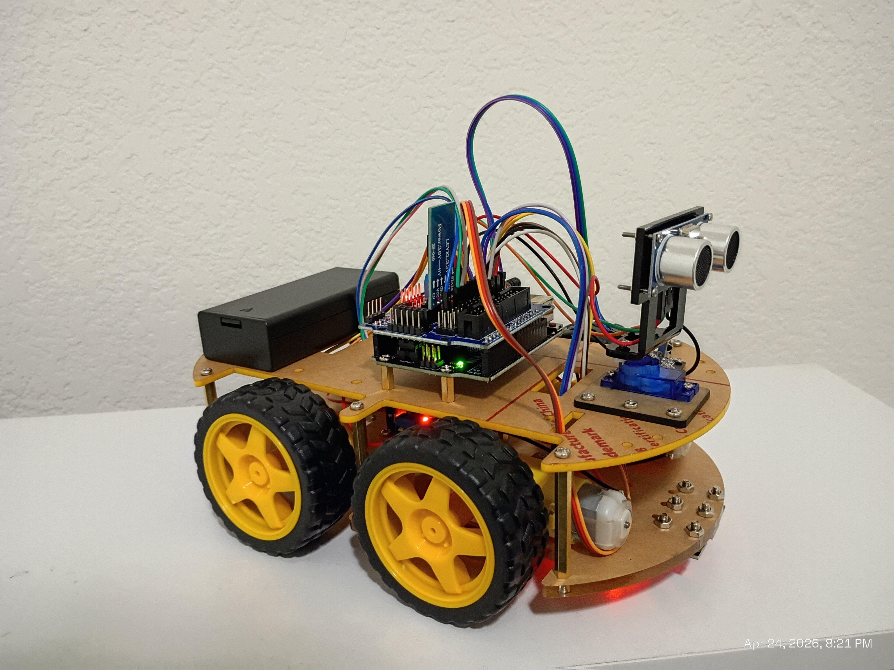

# Robot Car

> A 4-wheel Arduino robot car with Bluetooth control, IR remote, obstacle avoidance, and infrared line tracking, driven from a custom Android app.



An Arduino UNO with an HC-05/HC-06 Bluetooth module, a servo-mounted HC-SR04 and three IR line sensors. The Java Android app (Classic Bluetooth SPP) drives it with a hold-to-move D-pad and one-tap toggles for avoidance and line tracking.

**The firmware has never been run on the physical car.** Everything verified below is host-tested decision logic and compilation, not hardware behavior.


Rendered by `tools/render_figure.py` from `RobotCarCore` compiled with `g++`: (a) line-following motor commands for the 8 sensor states (bits = left, center, right), (b) the avoidance response over 1-60 cm (front = left = right). The firmware does not name wheel sides, so motors are labeled Motor A and Motor B. Regenerate: `uv run --with matplotlib python tools/render_figure.py`.

## Results

Verified locally (macOS, Arduino CLI 1.5.1, `arduino:avr` 1.8.8, JDK 17, Gradle 9.9.1):

- Host tests (`make -C firmware/test`): **112 checks, 0 failures**.
- UNO compile: **9,124 bytes flash (28% of 32,256), 551 bytes RAM (26% of 2,048)**.
- Android: `assembleDebug testDebugUnitTest lint` passes; **3 JUnit tests, 0 failures**, lint **0 errors**.
- CI (`.github/workflows/ci.yml`) runs the host tests, the UNO compile and the Android build on every push.

## How it works

`firmware/robot_car/robot_car.ino` is Arduino glue only (pins, `setup`/`loop`, sensor reads, motor writes); all decision logic lives in `firmware/libraries/RobotCarCore/`, an Arduino-free library that compiles and runs on the host.

## Protocol

Bluetooth commands are framed as `%X#` (for example `%F#`); anything else is ignored by the parser. Frames longer than 4 bytes stop the car.

| Command | Action |
|---------|--------|
| `F` | Drive forward (held ~500 ms) |
| `B` | Drive backward (held ~500 ms) |
| `L` | Rotate left (held ~300 ms) |
| `R` | Rotate right (held ~300 ms) |
| `S` | Stop |
| `T` | Enter line-tracking routine |
| `A` | Enter obstacle-avoidance routine |

`T` and `A` run their routine until a new command (typically `S`) arrives; other command characters parse as no-ops that leave the buffer in place, and the app never sends them.

IR remote keycodes (NEC): Up `0x46`, Down `0x15`, Left `0x44`, Right `0x43` drive or turn; OK `0x40` stops. IR and Bluetooth control can be used at the same time; whichever sends a command last takes effect.

The same table is shared by `RobotCarCore` and `CommandProtocol.java`; both test suites assert it.

## Wiring

| Pin | Component |
|-----|-----------|
| 2, 4 | Motor A direction (IN1, IN2) |
| 5 | Motor A PWM |
| 6 | Motor B PWM |
| 7, 8 | Motor B direction (IN3, IN4) |
| 9, 10, 11 | IR line sensors (Left, Center, Right) |
| 12 | IR receiver |
| A0 | HC-SR04 Echo |
| A1 | HC-SR04 Trigger |
| A2 | Servo (sensor pan) |

## Run it

```sh
git clone https://github.com/Creator101-commits/robot-car.git && cd robot-car

# Firmware: needs arduino-cli, the arduino:avr core and Servo@1.1.3
arduino-cli core install arduino:avr@1.8.8
arduino-cli lib install Servo@1.1.3
arduino-cli compile --fqbn arduino:avr:uno --libraries firmware/libraries firmware/robot_car
arduino-cli upload  --fqbn arduino:avr:uno --libraries firmware/libraries firmware/robot_car

# Android app: JDK 17 + Android SDK; a physical device for Bluetooth
cd android-app && ./gradlew assembleDebug && ./gradlew installDebug

# Host tests for the decision logic
make -C firmware/test
```

Pair the HC-05/HC-06 in Android Bluetooth settings first (PIN `1234` or `0000`). IDE alternatives: Arduino IDE opens `firmware/robot_car/robot_car.ino`; Android Studio opens `android-app/`.

## Changes from the original sketch

- **IR key reads:** the original called `ir.getCode()` up to 5 times per loop and `IRremote::loop()` clears `irRead` about 1 ms after a decode, so keypresses could be missed; now read once per loop.
- **Keymap bounds:** lookups iterated `KEY_MAX` (21) entries over a 17-entry table, reading past the end; now bounded by the real table sizes.
- **Compile fixes:** the sketch did not compile as committed (`IR_remote.h` missing, then `Servo.h`); resolved by proper libraries, plus generated launcher icons and a `Connected: %1$s` string resource.
- **Distance units:** ultrasonic distances are whole centimeters, truncated like the original (`(int)(echo_us / 58.00)`).

## Notes

- `firmware/libraries/IRremote/` is a vendored custom NEC IR decoder plus keymap with unknown provenance (no license header; likely derived from the robot kit or a tutorial).
- Not hardware-verified: on-car driving, motor wiring, sensor calibration, real Bluetooth pairing, IR decode, and physical Android devices (only compilation, unit tests and lint ran).
- The app requests only `BLUETOOTH_CONNECT` on API 31+, never scans, and its Android dependency versions are the newest supporting `minSdk 21`.
